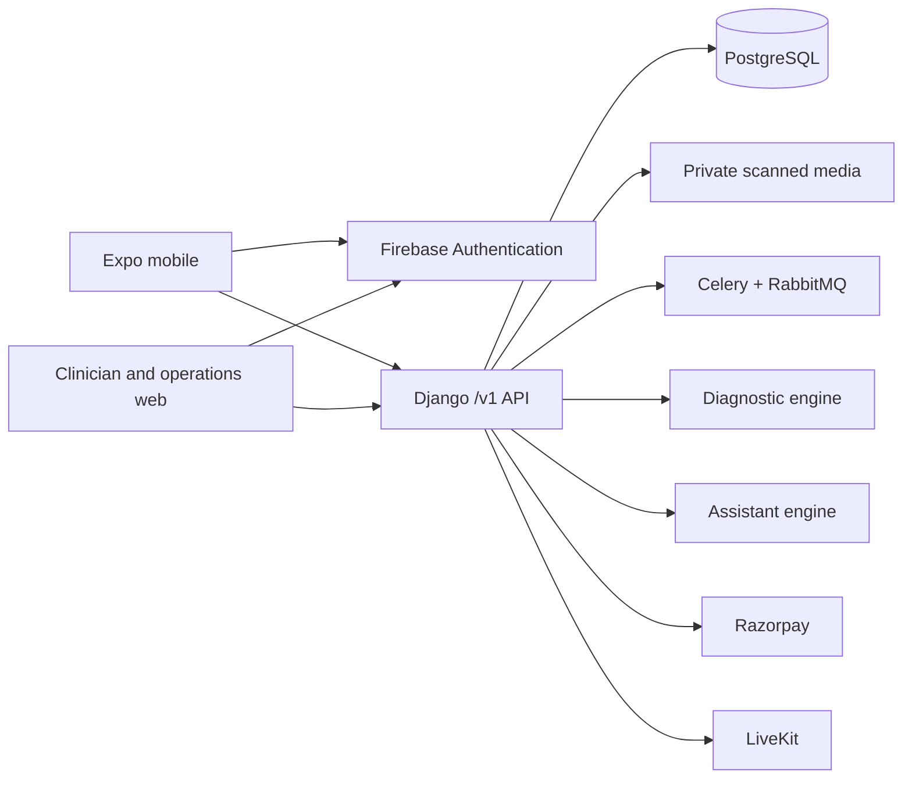

# NeuroNest

A care platform for children and adolescents with autism in India: a parent mobile app, clinician and operations web workspaces, a consent-enforced core API, and two separately deployable AI engines.

> NeuroNest uses Firebase Authentication for real account creation and verified-email sign-in. Supabase remains the hosted PostgreSQL, private-storage and Cron provider. Clinical authorization, provider verification, live payments, and diagnostic-model clearance remain separate release gates in the [readiness ledger](docs/READINESS.md).

## Contents

- [What it does](#what-it-does) · [Architecture](#architecture) · [Repository layout](#repository-layout)
- [Run it locally](#run-it-locally) · [Verify a change](#verify-a-change)
- [The domain](#the-domain) · [The API](#the-api) · [The AI engines](#the-ai-engines)
- [Web client](#web-client) · [Mobile client](#mobile-client)
- [Configuration](#configuration) · [Deployment](#deployment)
- [Security posture](#security-posture) · [Before a real launch](#before-a-real-launch)
- [Documentation](#documentation)

## What it does

| Area                      | What is implemented                                                                                                                                                                                                                       |
| ------------------------- | ----------------------------------------------------------------------------------------------------------------------------------------------------------------------------------------------------------------------------------------- |
| **Identity and family**   | Firebase email/password authentication with verification and recovery, server-enforced staff MFA when configured, several child profiles per family, guardian invitation and revocation, scoped access grants, an append-only audit trail |
| **Records and privacy**   | Quarantine-then-scan uploads, signed records and reasoned amendments, exports, consent expiry and revocation, privacy requests, a reviewed adulthood-transition workflow                                                                  |
| **Care marketplace**      | Provider application, review and suspension; availability slots; atomic appointment holds; booking, rescheduling and cancellation; secure messaging; clinical notes; therapy sessions and referrals                                       |
| **Money and video**       | Server-verified Razorpay checkout, refunds, double-entry ledger, reconciliation and payout safeguards; LiveKit consultation rooms with recording disabled by default                                                                      |
| **Development journal**   | Observations, goals and achievements, growth, vaccinations, therapy progress, reviewed articles and videos, a vetted resource directory                                                                                                   |
| **Diagnostic assistance** | Versioned screening workflow, eligibility and follow-up logic, explicit abstention, a research-only structured baseline, evaluation and a promotion gate that keeps prediction switched off                                               |
| **AI assistant**          | English/Malayalam retrieval over a reviewed corpus, enforced citations, safety routing and escalation, an opt-in record-context path that is disabled by default                                                                          |
| **Operations**            | A redacted durable-work queue with allowlisted retry, payment-dispute evidence review, versioned commercial and retention policy, privacy request handling                                                                                |

## Architecture



The core service owns every piece of patient, consent, booking, record and financial state. The two AI engines are stateless: they accept narrowly scoped authenticated requests, hold no database credentials, and cannot read or modify core data. Requests between core and an engine carry a shared `X-Service-Token`, and each engine refuses to answer at all if that secret is shorter than 32 characters.

`compose.yaml` segments the local stack into named networks — `database`, `jobs`, `engines`, `scanner`, `rtc` — so the engines cannot reach PostgreSQL or the broker even by accident.

Background work runs through a durable outbox rather than inline side effects. The local stack uses Celery beat and a worker. The hosted core uses a bounded Supabase Cron dispatcher for that same outbox; it does not replace malware scanning, managed video infrastructure, or model-training services.

## Repository layout

```
apps/web            React 19 + Vite client — parent, clinician and operations workspaces
apps/mobile         Expo / React Native parent app
services/core       Django 5.2 + DRF API, Celery worker and beat — the system of record
services/assistant  FastAPI education assistant (retrieval + governed generation)
services/diagnostic FastAPI screening and diagnostic-assistance engine
packages/contracts  OpenAPI schema and generated TypeScript types
infra               Local LiveKit config
scripts             dev-up / dev-down and the verification checks
docs                readiness ledger, runbook, policy, architecture, research
```

## Run it locally

Requirements: Docker with Compose, Node 24+, Python 3.13. On macOS `scripts/dev-up` can start its own Colima profile when Docker is unavailable.

```bash
npm ci && npm --prefix apps/web ci && npm --prefix apps/mobile ci
./scripts/dev-up
npm run dev:web
```

Copy `.env.example` to `.env`, configure `IDENTITY_PROVIDER=firebase`, `FIREBASE_PROJECT_ID`, `FIREBASE_WEB_API_KEY`, and the full one-line server-only `FIREBASE_SERVICE_ACCOUNT_JSON`. Copy Firebase's public web configuration into both client `.env` files. Open <http://localhost:5173>, create a family account, verify the email, then sign in. The API answers at <http://localhost:8000/health/>.

`dev-up` starts local infrastructure and applies migrations. It does not create user accounts. Firebase owns passwords, email verification, reset delivery, and sessions; the core provisions a local parent record only after it verifies a Firebase ID token with a verified email.

```bash
./scripts/dev-down     # stop the stack, keep the volumes
```

<details>
<summary><b>Running the API without Docker</b></summary>

The core service falls back to SQLite when no `DATABASE_URL` is set, which is enough for local API and web development:

```bash
cd services/core
python3 -m venv .venv && .venv/bin/pip install -r requirements.txt
ENVIRONMENT=development DJANGO_SECRET_KEY=local-only \
  ENGINE_SERVICE_TOKEN=local-engine-token-at-least-32-characters \
  CELERY_TASK_ALWAYS_EAGER=true \
  IDENTITY_PROVIDER=firebase \
  FIREBASE_PROJECT_ID=your-project-id \
  FIREBASE_WEB_API_KEY=your-firebase-web-api-key \
  .venv/bin/python manage.py migrate
```

Local JWT verification uses Firebase's public signing keys. A complete local username-sign-in flow, token revocation checks, and every production deployment also require the complete, server-only `FIREBASE_SERVICE_ACCOUNT_JSON` value; keep it out of the repository and every client environment.

Start the server with the same environment and point the web client at it with `VITE_API_URL`. Identity, payment, video and malware scanning report themselves unavailable rather than pretending to work — see `GET /v1/readiness/`.

</details>

## Verify a change

Most checks use isolated fixtures. Account creation, email verification/delivery, credential recovery, and staff MFA require a configured Firebase project and are verified separately.

| Command                                                                      | What it proves                                                                                                                                              |
| ---------------------------------------------------------------------------- | ----------------------------------------------------------------------------------------------------------------------------------------------------------- |
| `npm run format` / `npm run check:format`                                    | Formats (or checks) every service and client — `ruff format` plus Prettier                                                                                  |
| `uvx ruff@0.14.5 check .`                                                    | Correctness lint across all three Python services (unused names, bugbear, a targeted security set)                                                          |
| `npx pip-audit -r services/core/requirements.txt --strict`                   | Fails on a dependency with a known vulnerability; CI runs it for every service and both clients                                                             |
| `docker compose exec -T core python manage.py test api --noinput`            | **140 core tests** — authorisation, isolation, money, privacy, operations                                                                                    |
| `(cd services/assistant && .venv/bin/python -m unittest discover -s tests)`  | **15 tests** — corpus governance, safety routing, citation enforcement                                                                                      |
| `(cd services/diagnostic && .venv/bin/python -m unittest discover -s tests)` | **11 tests** — instruments, abstention, evaluation, promotion gate                                                                                           |
| `npm --prefix apps/web run typecheck && npm --prefix apps/web test`          | Web types, **23 unit tests**, and the 4.5:1 contrast floor across **both light and dark themes**                                                            |
| `npm --prefix apps/web run check:responsive`                                  | Renders every screen from 280px to 1920px and fails on sideways scroll, a wrapped or truncated navigation label, an off-screen selected tab, sub-10px text, or a touch target under 44px |
| `npm --prefix apps/mobile run typecheck && npm --prefix apps/mobile test`    | **24 mobile tests** — transport and page envelopes, offline draft replay and ordering, translated confirmations, dictionary completeness, validation, dates |
| `python3 scripts/dev-check.py`                                               | Local configuration is coherent                                                                                                                             |
| `python3 scripts/dev-service-check.py`                                       | Core and engine HTTP, authenticated LiveKit, clean-file acceptance and EICAR rejection                                                                      |
| `node scripts/smoke-api.mjs`                                                 | End-to-end API journey                                                                                                                                      |
| `npm run test:video` · `test:restore` · `test:load`                          | Video join with fake devices, backup restore integrity, load behaviour                                                                                      |
| `npm run check:schema && npm run check:contracts`                            | The 88-path OpenAPI surface still matches the checked-in TypeScript contract                                                                                |

Browser acceptance requires a verified account in a configured Firebase project. The video check uses fake media devices — it is not evidence that a physical camera works.

**Not covered:** physical Android/iOS devices, real payment provider behaviour, TURN and hostile networks, and any clinical validation of the diagnostic engine.

## The domain

**Roles.** `parent`, `doctor`, `therapist`, `mentor`, `admin`. The core owns roles and never accepts a browser profile field or Firebase profile/custom claims as authorization.

**Two ways to reach a child's data.** A `Guardianship` is family membership — a parent or invited guardian, optionally able to share. A `Grant` is delegated clinical access with an explicit purpose, scope list and expiry, issued _by_ a sharing guardian _to_ a verified practitioner. A grant is live only while its grantor is still an active sharing guardian, so revoking a guardian collapses everything they delegated.

**Scopes.** `records`, `observations`, `therapy`, `screening`, `messages`, `export`. Mentors can only ever hold `messages`.

`api/access.py` is the heart of the model and worth reading first:

- `can_access(user, child, scope)` — the single authorisation decision, checking adulthood, guardianship, practitioner standing and live grants in that order.
- `visible_children(user, scope)` — the set a user may see, loading all authorisation rows once rather than per child.
- `require_child(...)` raises rather than returning a boolean, so a missing check fails closed.

**Adulthood.** A child record does not silently become an adult's. Once the subject turns 18 new child-care entries stop and the record moves to a reviewed transition workflow before the now-adult subject manages it directly.

**Records** are drafted, then signed. A signed record is immutable; corrections are new records carrying `amendment_of` and a required reason.

**Attachments** are accepted only if the bytes match a PDF/PNG/JPEG signature; images are re-encoded to strip anything embedded, and the file sits in quarantine until a scanner clears it. Download re-checks the SHA-256 before serving.

**Money** is integer paise throughout. Every state change is driven by a signature-verified webhook or server reconciliation — never by the browser reporting success. `LedgerEntry` records capture and refund in double-entry form, rows lock in a fixed practitioner → slot → appointment → payment order, and out-of-order provider events (a refund arriving before its capture) are handled explicitly. Commercial terms come from a versioned policy artifact that production refuses to start without.

## The API

`/v1`, **90 paths**, browsable at `/v1/docs/` with the schema at `/v1/schema/`.

Bearer tokens are verified against Firebase's JWKS with RS256, Firebase issuer and project audience, and required `exp/iat/iss/aud/sub/auth_time/email/email_verified` claims. A verified email is mandatory; a first verified family sign-in provisions a local parent account, while staff remain approval-controlled and require a Firebase second-factor session in production. Throttling defaults to 60/min anonymous and 600/min authenticated.

During the migration, a verified Firebase identity with the same email as an existing account receives `firebase_identity_link_review_required`. A confirmation click cannot attach it: support must complete an independent identity review before an operator records a Firebase subject. First-time verified Firebase sign-ins with no matching local account still provision a new parent account.

| Group               | Resources                                                                                                               |
| ------------------- | ----------------------------------------------------------------------------------------------------------------------- |
| Family and consent  | `children`, `guardianships`, `grants`, `audit`, `privacy-requests`                                                      |
| Clinical            | `records`, `attachments`, `screenings`, `referrals`, `therapy-sessions`                                                 |
| Development journal | `observations`, `goals`, `growth`, `vaccinations`                                                                       |
| Marketplace         | `practitioners`, `provider-applications`, `slots`, `appointments`, `payments`                                           |
| Communication       | `messages`, `notifications`                                                                                             |
| Library             | `content`, `resources`                                                                                                  |
| Operations          | `operations`, `/v1/policies/`                                                                                           |
| Endpoints           | `/health/`, `/v1/readiness/`, `/v1/me/`, `/v1/preferences/`, `/v1/assistant/`, `/v1/exports/`, `/v1/webhooks/razorpay/` |

**Every list endpoint is paged.** A list answers with `{count, next, previous, results}`, 100 rows by
default and at most 500 via `?page_size=`. An unbounded list is an unbounded query, serialization and
render, all driven by data the caller does not control — an audit trail or a record set grows without
limit. Both clients unwrap the envelope for callers that just want rows, and keep it where truncation
matters, so the web client can tell you it is showing 100 of 340 rather than looking complete.

`POST /v1/observations/` and `POST /v1/appointments/` honour an `Idempotency-Key` header: replaying the same key returns the original response, and reusing it with a different body is a conflict.

`GET /v1/readiness/` reports which capabilities are actually configured. It reports `diagnostic_prediction.ready: false` unconditionally — that gate is not environment-driven.

## The AI engines

Both are stateless FastAPI services behind a shared service token, deployable and scalable apart from the core.

**Assistant** (`/health`, `/chat`) answers autism-education questions in English or Malayalam over a reviewed corpus. Before any model call it routes emergencies and individual medical decisions to fixed safety responses. Retrieval only considers sources whose editorial review is `approved` for the requested language, and every approved source carries a content hash so an edit invalidates its approval. Generated answers are rejected unless they cite only supplied sources, contain no URLs, avoid diagnostic certainty, false reassurance and dosing instructions, and are actually in the requested language. If generation is unavailable the user gets the reviewed source text rather than nothing. Sending a child's records is opt-in, off by default, and refused outright unless the provider agreement is enabled.

**Diagnostic** (`/health`, `/instruments`, `/screen`, `/predict`) runs a versioned screening workflow with eligibility checks, follow-up questions and explicit abstention when evidence is insufficient. `/predict` exists for evaluation and stays behind a clinical and regulatory promotion gate; the core service reports it unavailable, and instruments must be individually enabled with approved content and licensing.

## Web client

React 19, Vite, no router library and no component framework. `apps/web/src`:

```
App.tsx              session gate — boot, login, hand off
Workspace.tsx        the signed-in shell: nav, page chrome, dialogs, current view
use-workspace.ts     all session state, effects and server calls
workspace-context.ts the typed surface a view may reach for
routing.ts           URL <-> destination / tab / child
views/*.tsx          one module per destination
ui/*                 primitives, the generic ModalForm, ConfirmDialog, field helpers
i18n.ts styles.css   translations and the hand-written stylesheet
```

A view states its dependencies by destructuring `useWorkspace()`; `workspace-context.ts` is the one place that defines what is shared.

The URL is the source of truth for location: `/journey/goals?child=<id>`. Back and forward work, a reload keeps your place, and a link is shareable. Changing destination pushes history; refining a tab or child replaces it, so back leaves the destination rather than stepping through its tabs. Signing out clears the path and the child id so the next person on the device does not inherit them.

Colour is a token layer, not scattered hex: 199 distinct values collapsed into 47 clusters and then
into named roles, which is what makes a **dark theme** possible — it follows the reader's system setting
and only the palette changes. Both themes are held to 4.5:1 by `npm test`.

The interface is fully bilingual. Every consequential action — signing a record, revoking access, cancelling, refunding — confirms through an in-app dialog that is translated, explains the consequence, and focuses the safe choice.

## Mobile client

Expo / React Native parent app in apps/mobile. Notable pieces: src/draft-queue.ts holds observations written offline and replays them, preserving rejected and later entries while removing acknowledged ones; src/api.ts refuses insecure production endpoints; .native.tsx variants keep payment and video native-only. Scripts: start, android, ios, web, prebuild, typecheck, test, export.

## Configuration

The core service reads these; anything absent degrades to unavailable rather than to an insecure default.

| Variable                                                                | Purpose                                                                                                                                                              |
| ----------------------------------------------------------------------- | -------------------------------------------------------------------------------------------------------------------------------------------------------------------- |
| ENVIRONMENT, DJANGO_DEBUG                                               | ENVIRONMENT=production refuses to start with the placeholder secret or DEBUG=true                                                                                    |
| `DJANGO_SECRET_KEY`, `ALLOWED_HOSTS`                                    | Django essentials                                                                                                                                                    |
| `DATABASE_URL` _or_ `DATABASE_HOST`/`_PORT`/`_NAME`/`_USER`/`_PASSWORD` | PostgreSQL; the hosted core uses the Supabase transaction pooler, while development may use SQLite (`SQLITE_PATH`)                                                   |
| `DB_SSLMODE`, `DB_SSLROOTCERT`                                          | PostgreSQL TLS verification; production defaults to `verify-full` and the bundled Supabase root certificate                                                          |
| `CORS_ALLOWED_ORIGINS`, `CSRF_TRUSTED_ORIGINS`                          | Browser origins                                                                                                                                                      |
| `IDENTITY_PROVIDER`, `FIREBASE_PROJECT_ID`                              | Set `IDENTITY_PROVIDER=firebase`; Firebase project used as the token audience                                                                                        |
| `FIREBASE_WEB_API_KEY`                                                  | Firebase web API key for the server-only username/password bridge; not a signing secret                                                                              |
| `FIREBASE_SERVICE_ACCOUNT_JSON`                                         | Core-only Firebase Admin credential; production verifies ID-token revocation with it                                                                                 |
| `TRUST_PROXY_HEADERS`                                                   | Set `true` only after acceptance-testing a trusted proxy client address (`X-Vercel-Forwarded-For` on Vercel); username sign-in fails closed in production without it |
| `USERNAME_RATE_LIMIT_HMAC_KEY`                                          | Optional server-only, separately rotatable HMAC key for durable username/IP rate-limit buckets; defaults to `DJANGO_SECRET_KEY`                                      |
| `ENGINE_SERVICE_TOKEN`, `ASSISTANT_URL`, `DIAGNOSTIC_URL`               | Engine access; token must be ≥32 characters                                                                                                                          |
| `PATIENT_AI_ENABLED`                                                    | Gates sending records to the assistant; default off                                                                                                                  |
| `RAZORPAY_KEY_ID`, `RAZORPAY_KEY_SECRET`, `RAZORPAY_WEBHOOK_SECRET`     | Payments; live keys are refused by the adapter                                                                                                                       |
| `OUTBOX_SCHEDULER`, `OUTBOX_DISPATCH_TOKEN`, `OUTBOX_WORKER_ENABLED`    | Hosted outbox delivery; configure the Supabase Cron/Vault path in `docs/OPERATIONS.md`                                                                               |
| `LIVEKIT_URL`, `LIVEKIT_API_KEY`, `LIVEKIT_API_SECRET`                  | Video; production requires LiveKit Cloud for token revocation                                                                                                        |
| `CLAMAV_HOST`, `LOCAL_TEST_SCANNER`                                     | Malware scanning; without a scanner uploads stay quarantined                                                                                                         |
| `S3_BUCKET`, `AWS_REGION`, `S3_ENDPOINT_URL`, `PRIVATE_MEDIA_ROOT`      | S3-compatible private attachment storage (for example, Supabase Storage)                                                                                             |
| `CELERY_BROKER_URL`, `CELERY_TASK_ALWAYS_EAGER`                         | Local or separately managed durable-worker background work; not hosted by Vercel functions                                                                           |
| `EMAIL_*`, `DEFAULT_FROM_EMAIL`                                         | Notification mail; console backend by default                                                                                                                        |
| `BUSINESS_POLICY_PATH`                                                  | Approved commercial policy; production will not book without it                                                                                                      |

Engines read `ENGINE_SERVICE_TOKEN`, `APP_ENV`, `ALLOW_PATIENT_AI`, `CORPUS_PATH`, `OPENAI_API_KEY` and `OPENAI_MODEL`. Client variables are in `apps/web/.env.example` and `apps/mobile/.env.example`.

## Deployment

The hosted topology uses **Vercel** for the web client and core API function, **Firebase Authentication** for identity, and **Supabase** for PostgreSQL, private storage and Cron. The web build receives HTTPS `VITE_API_URL` plus Firebase's public web configuration (`VITE_FIREBASE_*`); it must never receive a Firebase Admin credential or Supabase service-role key. Configure the same Firebase project in web, mobile and core before inviting users. In the Vercel **core** production environment, set `TRUST_PROXY_HEADERS=true` only after independently verifying that the deployed trusted proxy supplies a valid, non-user-controlled client address through `X-Vercel-Forwarded-For`. A non-Vercel host must make the same verification for its forwarding configuration before relying on `X-Forwarded-For`. If that behavior is not verified, leave it false: the username/password bridge stays unavailable in readiness and returns a generic credential `403` in production. The existing `reminders` scheduler heartbeat must also be fresh because it performs bounded rate-limit cleanup. Set a separate server-only `USERNAME_RATE_LIMIT_HMAC_KEY` when possible; omission falls back to `DJANGO_SECRET_KEY`.

Vercel functions do not host Celery/RabbitMQ workers, ClamAV, or request-time model training. Supabase Cron dispatches the durable outbox and the bounded `reminders` maintenance job; scan acceptance, managed video revocation, and AI stay unavailable until their separately managed services are configured and qualified. Private attachments also require an approved S3-compatible store and scanner.

Migrations build indexes with `CREATE INDEX CONCURRENTLY` on PostgreSQL (`api/migration_operations.py`) so a deploy does not lock writes, falling back to a plain index on SQLite.

## Security posture

Enforced in code today:

- Production refuses to start with a placeholder secret, `DEBUG`; HSTS with subdomains and preload, secure cookies and TLS redirect are on.
- Roles and child access are server-owned; staff access requires a Firebase second-factor session in production.
- Every child-scoped read and write goes through `require_child`, and reads are recorded in an append-only audit trail.
- Uploads are content-sniffed, size- and megapixel-bounded, image-re-encoded, quarantined and scanned before they can be downloaded; downloads re-verify the hash and are served with `Content-Disposition: attachment` and a `sandbox` CSP.
- Payment state changes require a valid HMAC webhook signature; provider response bodies are never surfaced to clients.
- Background failures record only an exception type, never prompt, file, provider or credential text.
- The operations queue is redacted — no payload, object identifiers or raw errors — and retry is allowlisted so financial work cannot be replayed from the UI.

Known and deliberate: the web client holds its Firebase ID token in `sessionStorage`, which is exposed to XSS. Replacing it with a same-origin cookie session is a launch gate.

## Before a real launch

Beyond the production policy artifact at `BUSINESS_POLICY_PATH`, each of these blocks launch on its own:

a same-origin web session service with secure `HttpOnly` cookies, CSRF protection and a tested CSP · verified Firebase email delivery, authorized domains and MFA · reviewed clinician and instrument rights and validation · provider credentialing and marketplace terms · Razorpay KYC, live credentials and verified webhooks · LiveKit Cloud revocation and real-network testing · an OpenAI processing agreement with an approved corpus and evaluations · lawful retention and privacy policies · push credentials · physical Android and iOS testing · secure core hosting, DNS and secrets · accessibility validation · a live restore and reconciliation drill.

The diagnostic engine must stay unavailable until its separate clinical and regulatory promotion gate is met.

## Documentation

- [Readiness ledger](docs/READINESS.md) — capability-by-capability evidence and the exact release gates
- [Operations runbook](docs/OPERATIONS.md) — running the stack, Firebase identity and Vercel/Supabase release configuration, recovery
- [Commercial and retention policy](docs/POLICIES.md) — the immutable policy schema, retry and dispute limits
- [Implementation contract](docs/implementation-contract.md) — the current `/v1` integration surface
- [Architecture](docs/architecture.md) — trust boundaries, data model, AI constraints
- [Product framework](docs/product-framework.md) · [delivery plan](docs/delivery-plan.md)
- Research: [clinical AI related work](docs/research/clinical-ai-related-work.md) · [diagnostic data decision](docs/research/dataset-landscape.md) · [compliance](docs/research/compliance-operations.md)
- Engines: [diagnostic](services/diagnostic/README.md) · [assistant governance](services/assistant/README.md)
