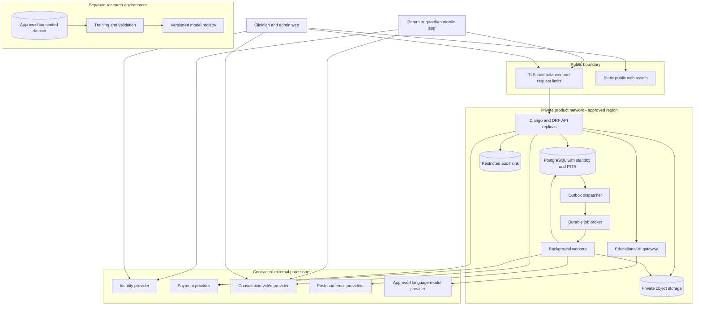
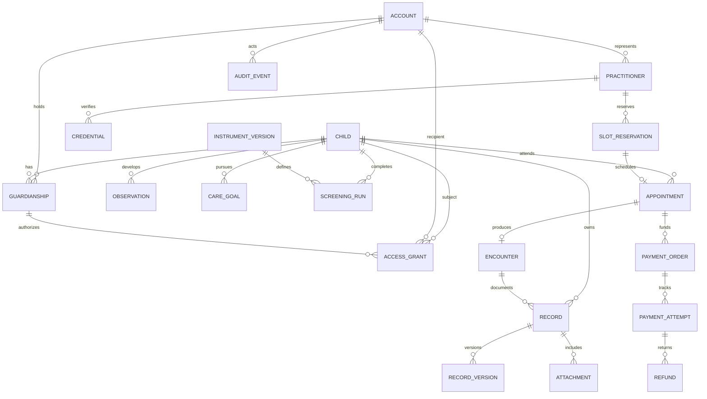
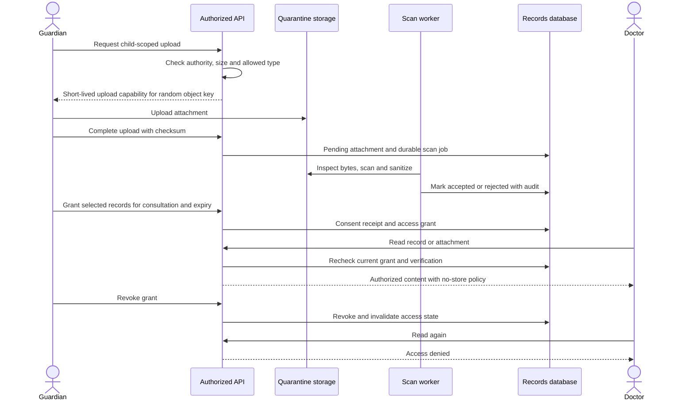

# NeuroNest production architecture

Status: implementation-aligned architecture, 8 September 2026. This repository uses Firebase Authentication for account creation and verified-email sessions, while Supabase provides PostgreSQL, storage and Cron. The core retains all roles, family relationships, consent and record authorization. The design and target sections below do not certify a clinical model, live vendor integration, security assessment, regulatory authorization or public deployment. India as the first market and children/adolescents as the target population are confirmed by the user.

The recommended platform is a React Native/Expo mobile app, a React clinician/admin web app, and a Django/DRF modular monolith backed by PostgreSQL, private object storage, and durable background workers. This keeps appointment, consent, record, and payment changes within one transactional system. Independent research infrastructure is justified by the separation between experimental AI and clinical care; a fleet of product microservices is not.

## 1. Architecture decisions and boundaries

| Decision        | Recommendation and rationale                                                                                                                                                                                                                                   | Alternative and trigger to reconsider                                                                                                                                                                     |
| --------------- | -------------------------------------------------------------------------------------------------------------------------------------------------------------------------------------------------------------------------------------------------------------- | --------------------------------------------------------------------------------------------------------------------------------------------------------------------------------------------------------- |
| Mobile          | React Native, TypeScript, Expo development builds; native production builds for Android/iOS. Share design tokens and API types with web, not every screen. Expo supports native libraries in development builds; native dependency changes require rebuilding. | Flutter is reasonable if the delivery team already has stronger Dart/native expertise. Separate Swift/Kotlin apps become justified by sustained platform-specific functionality, not this feature list.   |
| Clinician/admin | React web, keyboard-accessible layouts, explicit patient context. Administrative staff and clinical staff have different scopes. Internal Django admin may handle narrow operational metadata behind MFA, never substitute for scoped clinical workflows.      | Expo web can serve simple shared flows, but dense records, verification, and scheduling screens benefit from dedicated web composition.                                                                   |
| Backend         | Django/DRF modular monolith, supported stable versions pinned at implementation; PostgreSQL migrations and a versioned OpenAPI contract. Python also supports the research team without making research code part of the clinical request path.                | NestJS is a reasonable TypeScript-only alternative. FastAPI is suitable for an eventual isolated inference endpoint, but does not remove identity, permissions, admin, transaction, or audit work.        |
| Storage         | Managed PostgreSQL is authoritative for relational business state. Private encrypted object storage holds scanned records and media. JSONB only for versioned questionnaire responses and source payloads with validated schemas.                              | Document databases offer no clear advantage for overlapping appointments, financial constraints, or relationship-based access. Add a search index only when measured PostgreSQL search limits justify it. |
| Jobs            | Celery workers with a managed durable broker, transactional outbox in PostgreSQL, explicit retries/dead letters and business idempotency. Retain recoverable job state independently of the broker.                                                            | A smaller managed job runner is acceptable if it demonstrates equivalent delivery/recovery properties. Do not build a custom distributed workflow engine.                                                 |
| Deployment      | Managed containers with at least two stateless API replicas across availability zones; managed PostgreSQL with standby/PITR; separate API and worker scaling. Infrastructure as code and isolated environments.                                                | Kubernetes becomes a staffing/operations decision if the organization already operates it well. It is not necessary for this application.                                                                 |
| Payments/video  | Contract approved providers, server-created payment orders, provider-hosted checkout, server-minted short-lived video participant tokens.                                                                                                                      | Provider selection depends on India onboarding, settlement model, media routing, SDK testing, contract and data-processing review. No vendor is approved by this document.                                |
| AI              | Clinician-reviewed educational retrieval first; experimental screening prediction in a separate research boundary. Fine-tuning is an evaluated option, not a substitute for an evidence base.                                                                  | Model/service choice follows evaluation, permitted data use, language coverage, latency and procurement. Clinical deployment needs its own validation and regulatory decision.                            |

Capability references: [Expo development builds](https://docs.expo.dev/develop/development-builds/introduction/), [Django transactions](https://docs.djangoproject.com/en/5.2/topics/db/transactions/). Recommendations in the table are project design judgments, not vendor guarantees.

## 2. Deployment and trust boundaries

Public CDN caching is only for public application assets and approved public content. Patient responses, reports, private media, and signed URLs must not enter shared caches. Backups and logs belong to the same approved residency/processor decision as primary data; choosing an Indian database region alone does not establish end-to-end residency. Video traffic flows directly to the video provider, not through the application API. A patient's record is not sent automatically to video, payment, push, analytics, or AI vendors.

Firebase Authentication provides email/password sign-up, email verification, recovery and ID tokens. The core verifies Firebase's asymmetric JWTs and creates a local parent account only after verified-email confirmation. Keep roles and child access in the core, never user-editable Firebase profile/custom claims. Mobile uses OS-backed token storage; web must move to a server-side session with Secure/HttpOnly/SameSite cookies and CSRF protection before public release. Expo SecureStore is a token/key store, not a clinical-record database. [Expo SecureStore](https://docs.expo.dev/versions/latest/sdk/securestore/)

## 3. Product modules

| Module                   | Owns                                                                                               | Critical boundary                                                                                                                                          |
| ------------------------ | -------------------------------------------------------------------------------------------------- | ---------------------------------------------------------------------------------------------------------------------------------------------------------- |
| Identity and family      | Accounts, devices, guardianship evidence, child profiles, invitations, account recovery            | One login may represent a guardian of several children; several separately authenticated guardians may relate to one child. Never share a family password. |
| Consent and access       | Purpose-bound record grants, authority, expiry, revocation, audit                                  | Booking or payment does not grant access to all history.                                                                                                   |
| Development and records  | Observations, milestones, care goals, reports, growth, vaccination entries                         | Parent observations, screening results, and clinician-signed findings remain distinguishable.                                                              |
| Screening                | Instrument versions, permissions, eligibility, responses, deterministic scoring, referral output   | No diagnosis from a quiz or a research score. Respect instrument licensing and validated language/age boundaries.                                          |
| Provider directory       | Doctor/therapist credentials, verification, expiry/suspension, mentor role, referral listings      | Verified doctor, therapist, and mentor are different capabilities; a mentor cannot diagnose or access clinical records by default.                         |
| Booking and consultation | Availability, holds, appointments, consent receipt, attendance, encounter notes, therapy follow-up | Access and practitioner eligibility checked when booking, joining, reading and signing.                                                                    |
| Finance                  | Orders, payment attempts, ledger, refunds, disputes, settlements, parent financial history         | Amount/currency and clinician fee snapshot are server-owned. No card/CVV/UPI credential storage.                                                           |
| Education and support    | Reviewed articles/YouTube references, language/age tags, chatbot knowledge, mentor contact         | A guardian can seek a mentor, clinician or referral directly, regardless of screening score.                                                               |
| Operations               | Audit review, complaints, content review, privacy requests, incidents                              | Support staff see operational minimum; patient record access requires a separately authorized workflow.                                                    |

A future hospital, lab, pharmacy, insurer or ABDM connection is a contracted interoperability project with its own consent, identity matching and conformance work. The uploaded diagram's broad ecosystem does not mean these integrations exist or are part of the initial release commitment.

## 4. Domain model

This is a conceptual relationship diagram, not executable schema. Additional tables include organizations/practitioner memberships, grant-to-record/category selections, notification preferences, chat sessions, education resources, research consents, vaccination entries, growth measurements, referral requests, payment ledger entries, outbox items, and provider webhook receipts.

**Identity:** `Account` stores identity-provider subject and account state. `Child` is the data subject, not a login. `Guardianship` records child/account, relationship, verification evidence reference, authority scope, valid-from/to and disputed/revoked states. Invitations require authenticated acceptance and authority checks. Do not expose existing child identities through an invitation lookup. Guardianship disputes pause contested sharing pending a documented review; they cannot be solved by the first account to claim ownership. Adult transition requires a reviewed transfer of authority and fresh access choices.

**Access grant:** include child, grantor authority reference, specific practitioner/account or carefully defined care-team recipient, purpose (`consultation`, `therapy`, `parent-sharing`, separately `research`), permitted operations (`read`, `append`, `export`), record IDs/categories and record date window, valid-from/to, consent text/language/version, acceptance evidence, revoked-at, and linked encounter if relevant. Category access must explicitly say whether it covers future records. Consent to treatment, disclosure, teleconsultation, optional recording, AI processing, notifications and research are separately recorded choices. Research consent is not a field silently inherited from general app terms.

**Record:** child, record type, author role, organization, encounter, source, observed/effective time, recorded time, status, version and provenance. A signed clinician note is immutable; corrections are linked amendments with reason and author. Parents can append observations and request corrections; they do not overwrite clinician-authored findings. A report contains the relevant source versions, generation time and evidence provenance, not an untraceable merged narrative.

**Development:** milestones have source/framework version, age applicability, guardian observations, optional clinician review, and child-specific goals. Achievements recognize participation and personally chosen goals without ranking children or implying a diagnosis has improved. Growth measurements include units, method/source and effective time; clinical interpretation uses approved references. Vaccination completion needs source/date and review status; reminders use a versioned local schedule selected by the clinical team, not an invented universal schedule.

**Screening/research:** retain instrument/version, licensed translation, eligibility, item responses, follow-up status, scoring implementation version, result, interpretation text version and next step. Prediction records additionally capture model/data versions, intended-use match, confidence/abstention, missing inputs and reviewer action. Never rewrite a historical result when a model changes.

**Finance:** integers in currency minor units, immutable transaction references, append-only balanced ledger entries, unique provider IDs, captured/refunded totals constrained against the original amount. Refund and payout histories are separate from the clinical chart. Care providers see settlement/attendance details needed for their role; they do not receive parent billing credentials.

## 5. Authorization and revocation

Authorization is enforced in the API for every object, collection, export, attachment, background job and chat retrieval. A role alone is insufficient. The shared policy checks active account/session, child relationship or grant, professional capability and verification state, scope/purpose/time window, record sensitivity, and requested action. Derive subject IDs from validated relationships; an opaque UUID is not access control.

DRF does not automatically apply object permissions to every row of a list and does not automatically perform every create-object check. Querysets must be scoped and creation permissions enforced explicitly. This makes negative permission tests mandatory across detail, list, search, export and nested routes. [DRF permission limitations](https://www.django-rest-framework.org/api-guide/permissions/)

| Actor             | Default permitted view                                                      | Needs a further grant or action                                                                     |
| ----------------- | --------------------------------------------------------------------------- | --------------------------------------------------------------------------------------------------- |
| Verified guardian | Records covered by their authority; family management within that authority | Sharing with another guardian, practitioner export, research processing                             |
| Doctor            | Own directory/schedule and minimum appointment metadata                     | Child records within an active consultation/care grant; signed authorship within professional scope |
| Therapist         | Own schedule; assigned therapy workflow                                     | Relevant therapy records and goals, not unrestricted medical chart                                  |
| Mentor            | Published resources and guardian-initiated conversation                     | No general clinical record access; explicitly shared minimal context only                           |
| Finance support   | Order, amount, provider transaction, refund and contact minimum             | No screening answers, videos, clinical notes                                                        |
| Operational admin | Credential/content/workflow metadata                                        | Time-limited audited elevated access after a defined approval process                               |
| Research team     | Approved, minimized research dataset in research environment                | No standing production database credentials                                                         |

Revoke a grant in one transaction, increment its access version, invalidate associated cache/exports, and make subsequent API calls consult current server authority. Do not put child record permissions only in a long-lived JWT. Terminate affected live sessions where feasible and reject queued jobs on recheck. Worker payloads contain object IDs and authorization context, not an entitlement that lasts forever. Disable practitioner access immediately on suspension; review affected future bookings.

For private clinical downloads, use an authenticated streaming gateway that rechecks authority on each request; do not expose durable object URLs. Direct presigned URLs are bearer capabilities and remain usable until expiry/credential invalidation; expiry also does not stop a download already started. If used for a specific low-risk transfer, set a short lifetime, prohibit referrer/log leakage and document the remaining window. Neither revocation nor remote wipe can recall a file already downloaded by an authorized recipient. [S3 presigned URL behavior](https://docs.aws.amazon.com/AmazonS3/latest/userguide/using-presigned-url.html)

## 6. Records, private media and data flow

Uploads begin in quarantine. Enforce server-controlled object keys, allowlisted types, maximum sizes, byte-signature validation, checksum verification, malware scanning and decompression limits. An upload completion callback is not proof of safety. Render risky documents through sanitized previews; never serve user HTML/SVG as same-origin executable content. Sanitize metadata, including location/EXIF when unnecessary. Keep original and derived preview provenance where medically necessary. Check access again when promoting, viewing or exporting. Purge abandoned multipart uploads and unattached quarantined objects on a scheduled job.

Use encryption in transit and managed keys at rest with separated roles, audited key access and rotation. Restrict production database access; developers use synthetic fixtures. Logs contain request IDs, status, duration and internal event IDs rather than child names, prompts, record bodies, payment credentials or signed URLs. Audit events record actor, subject, purpose, action, result, grant/version and time; a restricted tamper-evident archive complements database audit rows. Audit logs are themselves sensitive.

YouTube resources store the video ID, title, clinician review, language, audience, license/permission notes, source link, transcript permission, review date and availability state. Use an approved embed or external link; do not download/rehost videos without rights. Public content recommendations can use non-sensitive tags. Opening a third-party video is a separate data flow and must not transmit a child's diagnosis or chart. Captions, readable summaries and low-bandwidth alternatives are required. Removed/unavailable videos need an editorial fallback.

## 7. Booking, payment and refund correctness

Use explicit state machines rather than boolean `paid`/`booked` flags:

- Reservation: `held → confirmed | expired | released`.
- Appointment: `awaiting_payment → confirmed → in_progress → completed`, with `cancelled` and `no_show` branches.
- Payment: `created → pending → authorized → captured`; failed attempts remain separate; `refund_pending → partially_refunded | refunded` tracks return of captured funds.
- Encounter: `draft → signed → amended`, independently of payment state.

Each slot reservation has practitioner/resource, UTC start/end, expiry and state. Store the user's timezone for display and the practitioner's IANA timezone for schedule rules. Handle DST and schedule changes even if India launches first. Prevent overlapping active reservations with PostgreSQL range/exclusion constraints over the relevant resource and half-open time range. For held/confirmed states, the constraint applies regardless of wall-clock expiry: expire old holds transactionally before allocating, with a periodic sweeper for cleanup. Do not use `now()` as the definition of an index predicate. PostgreSQL supports range exclusions suitable for overlap invariants. [PostgreSQL ranges and exclusions](https://www.postgresql.org/docs/current/rangetypes.html)

1. Authenticate guardian and validate child, practitioner status, slot, fee and cancellation policy. In a short database transaction, acquire the relevant resource lock, expire eligible old holds, insert the non-overlapping hold, persist a server-priced order intent and an outbox event. A proposed 10-minute hold is a product setting to test, not a payment-success guarantee.
2. Create the provider order outside the database transaction. Persist the provider reference. Recover network ambiguity by looking up the existing attempt before creating another order; retain one local request key and provider receipt/reference for reconciliation. Do not assume every provider endpoint supports idempotency.
3. Checkout receives only public key/order/amount parameters. The client success screen is provisional until the server verifies the provider state.
4. Validate webhook signature against the raw body and appropriate rotating secret; persist receipt with a unique provider event ID before acknowledging accepted delivery. Repeated and out-of-order events are expected. Process against server-owned order, account, currency and amount; never trust client totals. Razorpay documents raw-body signatures, event IDs for duplicates, and non-guaranteed ordering. [Razorpay validation and delivery](https://razorpay.com/docs/webhooks/validate-test/?preferred-country=IN)
5. Under one short transaction, record the financial state, lock the reservation, and confirm only if the same hold is valid and the slot can still be allocated. If payment arrives after expiry or cancellation, never displace a later booking. Mark `paid_unallocated`, initiate a tracked refund (or offer a new booking through a separately accepted flow), and notify the guardian clearly. The money ledger must still reflect captured funds.
6. A cancellation releases the reservation according to policy, records fee/refund calculation with the accepted policy version, and emits an outbox refund command. A refund request has a stable operation key; an ambiguous timeout triggers provider lookup/reconciliation before retry. Cap cumulative refunds, handle partial refunds/disputes, and expose pending versus completed states honestly.
7. Reconcile pending orders, captures, refunds and settlements with the provider on a schedule. Provider unavailability leaves a visible pending state and an operational alert. Staff cannot mark an unverified payment captured to make the UI look complete.

API idempotency keys are scoped to actor + operation, with a request-body hash and stored response. Reusing a key with different data returns a conflict. A new client retry must not create another appointment/refund. The booking/ledger/outbox commit is atomic; network delivery is at least once. Consumers deduplicate by business operation, not just message delivery ID. `on_commit()` alone does not guarantee a job reaches a broker after a process crash. Celery acknowledgement/retry behavior also requires configuration and idempotent task design; it does not provide exactly-once financial effects. [Celery tasks](https://docs.celeryq.dev/en/main/userguide/tasks.html)

Launch tests must demonstrate two simultaneous bookings cannot win the same slot; duplicate/out-of-order callbacks do not double-confirm or refund; captured money arriving after expiry is reconciled; cancellation racing capture converges; crashes between database commit and broker publication recover; and refund timeouts do not produce duplicate transfers.

## 8. Consultation, chatbot and research boundaries

Before joining a call, recheck appointment, identity, practitioner verification, grant and consultation consent. Mint participant tokens scoped to one room and role, with a short lifetime and waiting-room admission. An invitation URL alone cannot provide medical-record access. Default to no recording. If a later clinical workflow requires recording, it needs separately documented purpose, consent, retention and access controls. Provide a connection-loss/rebooking policy, accessible chat/caption options supported by the selected vendor, and a low-bandwidth fallback approved by clinical operations. Do not assume a video SDK provides end-to-end encryption or a particular data region; verify the contracted configuration.

The educational assistant retrieves only from versioned clinician-approved content and returns sources, uncertainty and an appropriate referral path. It must not diagnose, prescribe, invent screening scores, or block direct human help. Treat retrieved documents, YouTube descriptions and uploaded text as untrusted data, not instructions. Keep the tool surface narrow: initially no autonomous bookings, payments, record sharing, or record modification. Child-specific record retrieval requires a separate explicit purpose and current authorization; the baseline assistant can answer general questions without sending a chart to a model.

Build an evaluation set covering unsupported autism claims, emergencies, medication advice, coercive requests, private-data extraction, prompt injection, citation accuracy, English/local-language behavior and developmental diversity. Store versioned prompts, approved corpus versions and evaluation outcomes; production chat logs are not automatically training data. Fine-tuning, if evidence justifies it, uses permissioned expert examples and a separately evaluated model. A generative model cannot turn a small convenience dataset into a validated diagnostic instrument.

Research exports pass a documented consent/ethics/rights review, minimization, access approval and disclosure-risk assessment. Pseudonymized child data remains sensitive. No direct continuous production-to-training replication. Keep dataset manifests, subject-level split assignments, provenance, model cards and experiment logs in the research boundary. A model promotion is an explicit clinical/regulatory gate with a rollback plan; the product remains usable for care, education and bookings if experimental inference is disabled.

## 9. Proposed API contract

REST `/v1`; OpenAPI generated and checked in CI; UUIDs; ISO-8601 instants; pagination; bounded filters; structured error codes; correlation IDs; server-side input validation; no sensitive values in query strings. Use optimistic concurrency (`version`/`If-Match`) for editable drafts and explicit commands for business transitions.

| Route family                                                        | Operations                                       | Required controls                                                      |
| ------------------------------------------------------------------- | ------------------------------------------------ | ---------------------------------------------------------------------- |
| `/me`, `/sessions`                                                  | Profile, logout/revoke devices                   | Session ownership, step-up for recovery/security changes               |
| `/children`, `/children/{id}/guardians`                             | Child profiles, invitations, authority workflow  | Verified relationship, invitation expiry, no identity enumeration      |
| `/children/{id}/grants`                                             | Preview/create/revoke consent grants             | Grantor authority, scope preview, consent receipt, fresh authorization |
| `/children/{id}/records`                                            | List/read/add/version records                    | Row and field scopes, provenance, signed-note immutability             |
| `/attachments/uploads`, `/attachments/{id}/content`                 | Upload intent/completion and authorized download | Child scope, quarantine, size/type checks, no-store                    |
| `/children/{id}/observations`, `/goals`, `/growth`, `/vaccinations` | Development tracking                             | Explicit units/source/version; guardian or clinical authorship         |
| `/screenings`, `/screenings/{id}/submit`                            | Versioned questionnaire workflow                 | Licensing/eligibility, server scoring, immutable submitted response    |
| `/practitioners`, `/practitioners/{id}/availability`                | Verified directory, available slots              | Published fields only; credential expiry; bounded searches             |
| `/appointments/holds`, `/appointments/{id}`                         | Hold, view, cancel/reschedule                    | Idempotency, overlap constraint, state-transition authorization        |
| `/payment-orders`, `/refund-requests`, `/financial-history`         | Checkout setup and reconciliation view           | Server amounts, operation keys, role-restricted money history          |
| `/webhooks/{provider}`                                              | Payment/video events                             | Signature validation, body limit, durable deduplication; no user JWT   |
| `/appointments/{id}/join`, `/encounters/{id}/sign`                  | Video access and clinical documentation          | Fresh grant, practitioner status, room scope, immutable signature      |
| `/content`, `/assistant/sessions`, `/mentor-requests`               | Education, bounded chat, human support           | Content review/version, rate limits, source attribution; no score gate |
| `/exports`, `/privacy-requests`                                     | Record access/export/deletion workflows          | Step-up authentication, scope, job recheck, delivery expiry and audit  |

Names in shortened route cells are conceptual route families, not implemented endpoints. Add a dedicated consent-aware research request API only after that workflow is approved; do not expose model training as a public application endpoint.

## 10. Offline and mobile behavior

Public educational content, app navigation and locally authored unsent observations may work offline. Store private drafts only with platform-backed encryption keys, minimal cached content, explicit expiry, and an account/child identifier on every draft. Clear caches on logout/account switch; suppress sensitive app-switcher snapshots and notification previews where supported. Screen-reader labels, scalable text, reduced motion, sufficient contrast, captions and predictable controls are release requirements.

Clinical chart browsing, consent changes, screening submission/result calculation, appointment confirmation, payments, video joining and chatbot record retrieval require online server validation. An unsent draft is visibly unsynced; offline observations use a client operation ID, source timestamp and server timestamp on eventual upload. Append observations without silently overwriting existing entries; conflicts in editable records request a reviewed merge. Connectivity return must recheck active authority before synchronization. Never tell users that a booking is confirmed or a consent revocation reached the server while offline.

Full offline charts are deliberately outside the proposed launch architecture because revocation and shared-device risk become materially harder. If field-care workflows require them, define encrypted device enrollment, expiration, managed access and unavoidable recall limitations as a separate approved capability.

## 11. Retention, privacy operations and interoperability

Retention is a configurable approved policy by data class, purpose, jurisdiction and legal-hold status. The following are engineering proposals, not statements of statutory periods: abandoned uploads 24 hours; downloadable exports 24 hours; sensitive mobile drafts seven days unless explicitly renewed; optional non-security aggregate telemetry 30 days, only where no longer legal/security retention applies; required ICT/security logs follow the India retention policy (including applicable CERT-In 180-day requirements), and audit/clinical evidence follows its own schedule; chatbot conversation history off by default or user-opt-in with a reviewed short retention period. Medical records, professional notes, consent evidence, audit trails and financial records need a clinical/legal retention schedule before launch; do not assign a guessed global duration.

Withdrawal stops future processing under that consent and triggers appropriate revocation/deletion workflows. It does not silently delete records that must be retained under another established basis. Explain retained categories, reason and access restrictions to the requester. Deletion runs through database rows, objects/previews, derived search data, processor requests and expiring backups; maintain a minimal deletion ledger so restored backups do not resurrect deleted content. Hold immutable backups only for the approved finite window and restrict them to recovery. Export and erasure are audited background workflows with identity verification, a documented response owner, failure alerts and completion evidence.

Use an internal relational model and a mapping/export boundary rather than a FHIR server for every application object. Proposed FHIR R4 mapping follows the standard's resource vocabulary; this is not a claim of conformance or ABDM certification. [HL7 FHIR R4 resources](https://hl7.org/fhir/R4/resourcelist.html)

| NeuroNest concept               | Candidate FHIR resource(s)                        | Mapping constraint                                                                        |
| ------------------------------- | ------------------------------------------------- | ----------------------------------------------------------------------------------------- |
| Child, guardian                 | Patient, RelatedPerson                            | Identity matching and verified relationship need explicit provenance                      |
| Doctor/therapist, clinic        | Practitioner, PractitionerRole, Organization      | Preserve credentials, role, location and validity                                         |
| Access authorization            | Consent                                           | App enforcement remains necessary; resource export does not enforce access                |
| Milestone/growth measurement    | Observation                                       | Approved terminology, units, time and source; do not encode an observation as a diagnosis |
| Screening                       | Questionnaire, QuestionnaireResponse, Observation | Preserve instrument licensing/version, scoring and follow-up provenance                   |
| Clinician-established diagnosis | Condition                                         | Only signed authorized clinical findings, distinct from a screening result                |
| Clinical report/document        | DiagnosticReport, DocumentReference               | Select according to document semantics; not every uploaded file is a diagnostic report    |
| Schedule/booking/visit          | Schedule, Slot, Appointment, Encounter            | Map status transitions and timezone semantics carefully                                   |
| Therapy goals/plan              | Goal, CarePlan                                    | Include author, review state and patient-specific goals                                   |
| Vaccination history             | Immunization                                      | Distinguish reported administration from a planned reminder                               |
| Access and authorship events    | AuditEvent, Provenance                            | Retain internal audit fidelity, including denied access                                   |

Implement only the profiles and terminology sets required by a contracted recipient. Validate samples, negative cases, identity matching, consent propagation, amendment handling and import deduplication against that recipient's current specification. A FHIR-shaped JSON payload is insufficient evidence of interoperability.

## 12. Reliability targets and operational readiness

The supplied SRS's 99% availability excluding maintenance and unspecified-load response target below three seconds are starting requirements. Proposed production strengthening: **99.9% monthly availability including planned maintenance** for core authenticated records/booking APIs, **RPO ≤15 minutes** and **RTO ≤4 hours** for the agreed disaster scenario. These are targets, not measured achievements or an assurance that every vendor meets them.

| Indicator              | Proposed target / measurement                                                                                                                                      |
| ---------------------- | ------------------------------------------------------------------------------------------------------------------------------------------------------------------ |
| Core availability      | 99.9% successful valid core requests over a rolling 30-day window; synthetic read/write checks plus real requests; roughly 43.2 minutes error budget in 30 days    |
| Core latency           | p95 <1 second, p99 <3 seconds for defined ordinary record/booking API requests at an agreed load; exclude file transfer/AI generation but measure those separately |
| Mobile stability       | ≥99.5% crash-free sessions, measured by OS/app version with privacy-preserving telemetry                                                                           |
| Payment reconciliation | Captures normally reflected within 60 seconds of verified delivery; unresolved pending states alert within 15 minutes; external delivery delay shown separately    |
| Background work        | Queue age and attempt counts by job type; time-sensitive notification/hold jobs alert before user impact                                                           |
| Disaster recovery      | Restore evidence proves RPO/RTO for database and required objects/config/keys together, not database-only backups                                                  |
| Authorization          | No tolerated cross-child access in release tests; every record/export/attachment read audited; revocation checked on next authorized request                       |

Capacity planning requires actual assumptions before procurement: monthly active guardians, children per family, peak appointments/hour, concurrent calls, average media upload size, retention, chatbot messages and country/language mix. Load-test at forecast peak and at least twice peak; measure database locks, queue age, storage egress and vendor quotas. Scale stateless replicas/workers first. Isolate long-running inference and document rendering so they cannot consume booking workers. Do not add caches for permissions or booking correctness merely to meet a synthetic benchmark.

**CI and release gate:** lint/type checks, dependency/secret scanning, tests on real PostgreSQL semantics, migration checks, generated API contract compatibility, reproducible signed mobile builds and artifact provenance. Mandatory integration scenarios cover role/object permissions, revoked/expired/disputed guardian access, doctor suspension, attachment quarantine, screening instrument versions, booking/payment races, duplicate jobs, signed-note amendments, deletion/restore handling, accessibility, and low-connectivity recovery. External provider sandboxes and contract tests complement tests; they do not prove live money/video behavior. Staging contains synthetic/de-identified approved test data. A clinician reviews patient-facing medical copy and the assistant evaluation report before release.

Use expand/migrate/contract database changes and backwards-compatible APIs for older mobile apps. Stage app-store rollout and compatible signed over-the-air updates; native dependency changes require native releases. Feature flags can disable the chatbot, research inference or a broken payment method without disabling records. Rollback is a reviewed procedure; destructive database migrations need a forward recovery plan, not a promise that redeploying an old image restores deleted data.

**Incident runbook:** on-call acknowledges; classify clinical/privacy/payment/availability impact; disable the affected capability or freeze unsafe writes; preserve restricted evidence; identify affected subjects/orders; involve clinical/privacy/finance owners; reconcile durable state before replaying jobs; communicate through the approved channel; document correction and prevention. Do not include patient data in a public status page. A clinical safety escalation goes to clinical operations, not only the engineer on call.

**Database/object disaster runbook:** declare incident and stop conflicting writes; choose a recovery point consistent with available objects; restore PostgreSQL/PITR into an isolated network; verify schema, keys, object versions and checksums; replay deletion restrictions; reconcile payment-provider captures/refunds and outbox jobs before re-enabling outbound effects; validate consent/revocation state; run synthetic authorized and denied workflows; switch traffic under an incident owner's control; record actual data loss/recovery time. Test before launch, repeat quarterly and after major persistence changes. Use periodic restore tests in addition to daily backup-success monitoring. Keep recovery credentials and infrastructure definitions accessible when the primary region/account path is unavailable.

**Production acceptance evidence:** signed requirements/clinical scope, approved retention and processor contracts, threat model and authorization tests, independent security assessment with material findings resolved, instrument permissions, clinician verification workflow, accessibility/device checks, provider reconciliation tests, successful restore drill, staffed on-call/clinical escalation, support/refund procedures, monitored staged rollout and a clinical AI decision gate. Creating this design does not satisfy these gates; implementation and measured evidence must follow.
